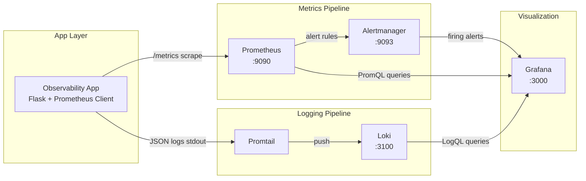

# DevOps Observability Lab

A complete observability stack for a containerized Python application, deployable with a single Docker Compose command. The system collects **metrics** (Prometheus + Grafana), **logs** (Loki + Promtail), and **alerts** when the application error rate exceeds 5 errors per minute.

## Quick Start

```bash
docker compose up -d --build
```

| Service       | URL                          | Credentials   |
|---------------|------------------------------|---------------|
| Application   |  http://localhost:8080        | —             |
| Prometheus    | http://localhost:9090        | —             |
| Grafana       |  http://localhost:3000       | `admin` / `admin` |
| Alertmanager  | http://localhost:9093        | —             |
| Loki          | http://localhost:3100        | —             |

Stop the stack:

```bash
docker compose down
```

---

## Architecture Diagram



**Data flow summary**

1. The application exposes a `/metrics` endpoint and writes structured JSON logs to stdout.
2. Prometheus scrapes metrics every 15 seconds and evaluates alert rules.
3. Promtail discovers Docker container logs, parses JSON fields, and ships them to Loki.
4. Grafana queries Prometheus (metrics), Loki (logs), and Alertmanager (alerts) for dashboards and alerting.

---

## Implementation Details

### Logging Strategy: Loki + Promtail

This lab uses **Grafana Loki** with **Promtail** instead of the ELK stack.

| Component | Role |
|-----------|------|
| **Application** | Emits one JSON object per log line via `python-json-logger` (fields: `timestamp`, `level`, `event`, `error_type`, `duration_ms`, etc.) |
| **Promtail** | Uses Docker service discovery to tail container logs, extracts JSON labels (`level`, `event`, `service`), and pushes to Loki |
| **Loki** | Indexes log metadata (labels) rather than full-text content, keeping storage efficient |
| **Grafana** | Queries Loki with LogQL (e.g. `{service="app"} \| json \| event="application_error"`) |

Loki was chosen for tighter integration with Grafana and lower operational overhead compared to Elasticsearch for this lab-scale deployment.

### Application Instrumentation

Custom Prometheus counters (see [`app/main.py`](app/main.py)):

- `app_requests_total{method, endpoint, status}` — incremented on every HTTP request
- `app_errors_total{error_type}` — incremented on `/error` and `/burst-errors`

Useful endpoints:

| Endpoint | Purpose |
|----------|---------|
| `GET /` | Service info |
| `GET /health` | Health check |
| `GET /work` | Simulates normal traffic |
| `GET /error` | Generates a single error + JSON log |
| `GET /burst-errors?count=10` | Generates multiple errors quickly |
| `GET /metrics` | Prometheus exposition format |

### Alerting

**Prometheus rule** ([`prometheus/rules/app_alerts.yml`](prometheus/rules/app_alerts.yml)):

```yaml
expr: sum(increase(app_errors_total[1m])) > 5
for: 1m
labels:
  severity: critical
```

The alert fires when more than 5 errors occur within a 1-minute window, sustained for 1 minute. A matching Grafana unified alert rule is also provisioned for visibility in Grafana's Alerting UI.

---

## How to Trigger the CRITICAL Alert

Wait ~30 seconds after `docker compose up` for Prometheus to begin scraping.

**Option A — helper script (Windows PowerShell):**

```powershell
.\scripts\trigger-alert.ps1
```

**Option B — helper script (Linux/macOS):**

```bash
chmod +x scripts/trigger-alert.sh
./scripts/trigger-alert.sh
```

**Option C — manual curl:**

```bash
# Generate 10 errors in one request (exceeds 5/min threshold)
curl http://localhost:8080/burst-errors?count=10

# Or fire individual errors rapidly
for i in $(seq 1 10); do curl -s http://localhost:8080/error; done
```

**Verify the alert:**

1. **Prometheus** → http://localhost:9090/alerts — `HighApplicationErrorRate` should show **FIRING**
2. **Grafana** → Alerting → Alert rules — rule `HighApplicationErrorRate` in folder *Observability Lab*
3. **Dashboard** → *Observability Lab - Application Dashboard* — *Errors per Minute* panel should exceed 5

> Alerts may take up to 2 minutes to transition to FIRING because of the `for: 1m` duration.

---

## Evidence (Screenshots)


grafana.png


## Analysis

### Why is JSON-structured logging more efficient than plain text logs?

Plain text logs require regex parsing at ingest time — each log line must be pattern-matched to extract fields like timestamp, level, or user ID. This is slow, fragile (format changes break parsers), and prevents efficient indexing.

1. Why is JSON-structured logging more efficient than plain text logs?
Plain text logs are unstructured: fields like timestamp, level, and error type are embedded in a string. To use them, a log pipeline must parse each line with regex or pattern rules, which is slow, brittle (one format change breaks parsing), and hard to query reliably.

JSON-structured logs are self-describing: every field is a key–value pair ("level": "error", "error_type": "timeout"). Ingest tools like Promtail can parse them once at collection time and index important fields as labels in Loki. That makes filtering fast and precise — e.g. {service="app"} | json | event="application_error" — without scanning every line with regex. Downstream tools (Grafana, alerts) can aggregate and correlate on structured fields directly, which reduces CPU use and improves query performance at scale.

2. What is the fundamental technical difference between 

What it stores
Numeric time-series: counters, gauges, histograms
Discrete log lines (text events)
Data model
Metric name + labels + float value over time
Log stream labels + compressed log content
Indexing
Indexes metric names and label sets
Indexes labels only, not full log text
Query language
PromQL — rates, sums, thresholds
LogQL — label filters + JSON parsing + line filters
Cardinality
Low — designed for aggregated measurements
Higher — one entry per event, but label cardinality must be controlled
Best for
“How many errors per minute?”
“What exactly happened in this request?”


3. How would you handle long-term log retention (e.g., 6 months) without depleting disk resources?
Retention policies — Set Loki’s retention_period (e.g. 180 days for 6 months) so old data is deleted automatically by the compactor instead of growing forever.

Tiered / object storage — Keep recent logs on fast local disk; move older chunks to S3, GCS, or Azure Blob. Loki supports object_store: s3 so hot data stays local and cold data uses cheaper storage.

Compaction — Use Loki’s compactor to merge small chunks, deduplicate, and remove expired data on a schedule.

Low-cardinality labels — Put high-cardinality data (user IDs, request IDs) in the log line body, not as labels. High label cardinality explodes index size and disk use.

Ingest filtering — Drop or sample noisy logs at Promtail (e.g. debug/trace, verbose health checks) so only useful logs are stored.

Archival for compliance — Export logs that must be kept for legal/audit reasons to cold archive (e.g. S3 Glacier), then delete them from the live cluster.

Together, these keep the live cluster lean while still meeting a 6-month retention requirement without filling the disk.
---

## Project Structure

```
.
├── app/                          # Instrumented Flask application
├── prometheus/                   # Scrape config + alert rules
├── alertmanager/                 # Alert routing
├── loki/                         # Loki storage config
├── promtail/                     # Log collection config
├── grafana/provisioning/         # Datasources, dashboards, alert rules
├── scripts/                      # Alert simulation helpers
├── docs/screenshots/             # Evidence screenshots
└── docker-compose.yml            # Single-command deployment
```

## License

Educational use — DevOps Observability Lab assignment.
